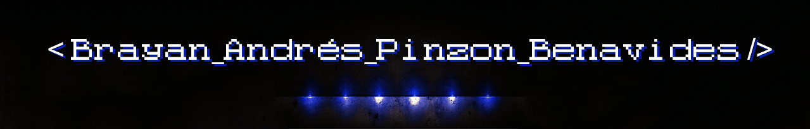

<!-- =========================== BANNER =========================== -->

  

 

<!-- =========================== HEADER =========================== -->
<h1 align="center">
  
</h1>

<!-- =========================== SOCIAL =========================== -->

  
  
  

 

<!-- =========================== ABOUT ME =========================== -->
<h2 align="center">👨‍💻 About Me</h2>

> 💼 **Middle Product Developer** at **Yeapp** — building products end-to-end.
>
> 🎓 **Systems Engineer** graduate from **Universidad del Cauca** (Dec 15, 2023).
>
> 🚀 4+ years of hands-on experience across the entire development lifecycle.

- 🔭 Currently working as a **Middle Product Developer** at **Yeapp**
- 🌱 Currently learning mobile development and refining my web development skills
- 🦾 I love challenges and continuous learning
- 👾 Strategy game lover
- ⚡ Fun fact: I'm a huge fan of VS Code

 

<!-- =========================== EXPERIENCE =========================== -->
<h2 align="center">💼 Experience</h2>

| Period | Role | Company |
| :---: | :--- | :---: |
| `Jan 2026 — Present` | **Middle Product Developer** | Yeapp |
| `Jun 2024 — Jan 2026` | **Full Stack Developer** | Yeapp |
| `Apr 2023 — Jun 2024` | **Junior Developer** | Yeapp |
| `Jun 2022 — Apr 2023` | **Amateur Developer** | Yeapp |

> 🚀 4+ years of continuous growth at **Yeapp** — from amateur developer to product development.

 

<!-- =========================== WORK @ YEAPP =========================== -->
<h2 align="center">🏢 Work @ Yeapp</h2>

  

<table align="center">
  <tr>
    <th align="left">Project</th>
    <th align="center">Tech</th>
  </tr>
  <tr>
    <td><code>Yeapdata-Process-Model</code></td>
    <td align="center"></td>
  </tr>
  <tr>
    <td><code>avianca-frontend</code></td>
    <td align="center"></td>
  </tr>
  <tr>
    <td><code>avianca-backend</code></td>
    <td align="center"></td>
  </tr>
  <tr>
    <td><code>asamblea</code></td>
    <td align="center"></td>
  </tr>
  <tr>
    <td><code>matriz_accesos</code></td>
    <td align="center"></td>
  </tr>
</table>

> 🔒 Internal private repositories of [Yeapp-io](https://github.com/Yeapp-io) — built and maintained as part of my daily work.

 

<!-- =========================== OTHER WORK =========================== -->
<h2 align="center">🛠️ Other Projects</h2>

<table align="center">
  <tr>
    <th align="left">Project</th>
    <th align="center">Tech</th>
  </tr>
  <tr>
    <td><code>mndrn</code> — MNDRN store and administrative panel</td>
    <td align="center"></td>
  </tr>
</table>

> 🔒 Private repository of [andrewgeek14](https://github.com/andrewgeek14).

 

<!-- =========================== EDUCATION =========================== -->
<h2 align="center">🎓 Education</h2>

| Period | Degree | Institution |
| :---: | :--- | :---: |
| `Dec 15, 2023` | **Systems Engineering** (Ingeniero de Sistemas) | Universidad del Cauca |

 

<!-- =========================== LANGUAGES =========================== -->
<h2 align="center">🌐 Languages</h2>

  
  
  

 

<!-- =========================== PROJECTS =========================== -->
<h2 align="center">🚀 Personal Projects</h2>

<table align="center">
  <tr>
    <td align="center" width="64">
      
    </td>
    <td>
      <a href="https://github.com/Satori-MMA" target="_blank"><b>Satori MMA</b></a> — Web application for the Satori MMA Pasto martial arts academy, allowing them to offer courses to their clients.
       
      
    </td>
  </tr>
  <tr>
    <td align="center" width="64">
      
    </td>
    <td>
      <a href="https://github.com/MyUnicaucaGit" target="_blank"><b>Unicauca Repository</b></a> — My personal university repository with projects like food delivery apps, wave simulations, Python exercises and more.
       
      
    </td>
  </tr>
  <tr>
    <td align="center" width="64">
      
    </td>
    <td>
      <a href="https://github.com/Notera-App" target="_blank"><b>Notera App</b></a> — Platform presented at the Yeapp hackathon to take notes in a different way and generate study methods.
       
      
    </td>
  </tr>
</table>

  

 

<!-- =========================== PINNED REPOS =========================== -->
<h2 align="center">📌 Pinned Repositories</h2>

  
  
  
  

 

<!-- =========================== TECH STACK =========================== -->
<h2 align="center">🛠️ Tech Stack</h2>

<h4 align="center">Languages</h4>

  
  
  
  
  
  
  

<h4 align="center">Frontend</h4>

  
  
  
  

<h4 align="center">Backend</h4>

  
  
  

<h4 align="center">Databases</h4>

  
  
  

<h4 align="center">Tools</h4>

  
  
  
  
  

 

<!-- =========================== CERTIFICATIONS =========================== -->
<h2 align="center">🎓 Certifications</h2>

  
  
  

  
📜 View all certifications

   

  **☁️ Cloud & AI**
  - Azure Fundamentals (AZ-900)
  - Introducción al Machine Learning
  - Curso de IA 2026
  - Iniciación a los flujos de trabajo con IA
  - Iniciación al desarrollo con IA
  - Redis IA-51 — Encuentro Internacional de Tendencias de la Inteligencia Artificial

  **⚡ Automation & Low-Code**
  - Curso de Power Apps y Power Automate
  - Automatización con N8N

  **🌐 Web Development**
  - Desarrollo Web 1
  - Desarrollo Web 2
  - Curso Profesional de Git

  **🚀 Professional**
  - Scrum Foundation Professional Certification (SFPC)
  - Inspirando al estudio con Google
  - Certificado de Curso de Trabajo Remoto
  - Tecnologías de la Información para servidor público

  **🗣️ Languages**
  - Curso básico de portugués para hispanohablantes
  - Estrategias para aprender inglés en línea

 

<!-- =========================== GITHUB STATS =========================== -->
<h2 align="center">📊 GitHub Stats</h2>

  
  
  

 

<!-- =========================== SNAKE ANIMATION =========================== -->
<h2 align="center">🐍 Contribution Snake</h2>

  

 

<!-- =========================== QUOTE =========================== -->
<h2 align="center">💡 Quote of the Day</h2>

  

 

<!-- =========================== CONTACT =========================== -->
<h2 align="center">📬 Contact</h2>

  
  

 

<!-- =========================== FOOTER =========================== -->

  
  
    
  ⭐️ From <a href="https://github.com/AndresPinzon14">AndresPinzon14</a>

